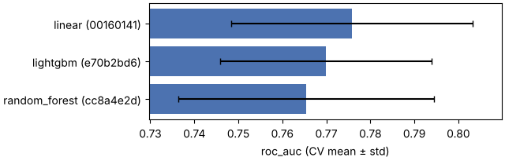
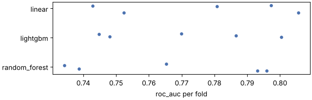
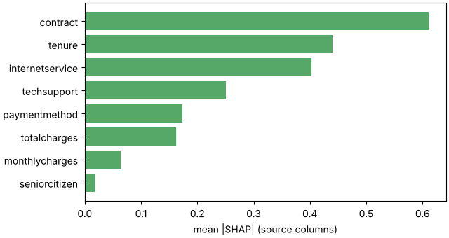
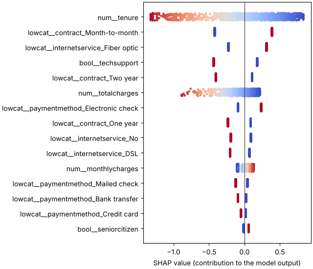
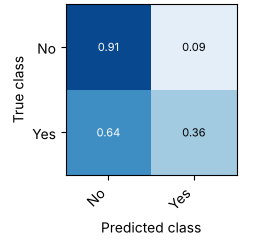
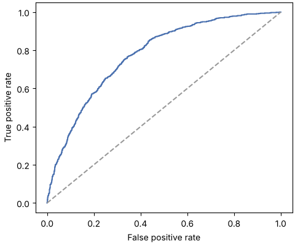
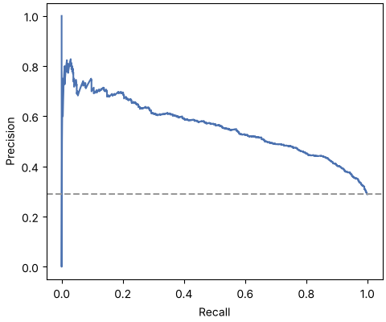
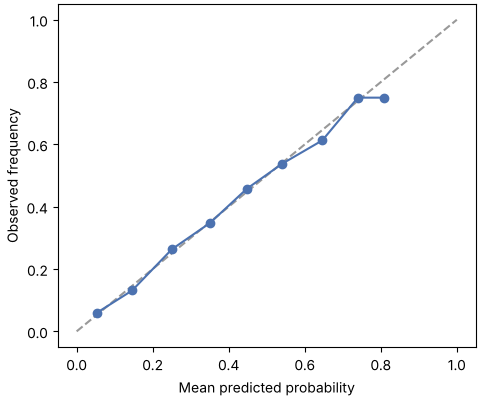

# TabPilot report

Run 01M7X1Y3DY8M8BAP372XZT44GS · telco\_churn.csv · status completed

## 1. Summary

| Item | Value |
| --- | --- |
| Task | binary |
| Target | churn |
| Final model | linear (0-linear-00160141) |
| Primary metric | roc\_auc (maximize) |
| CV score (DEV, mean ± std) | 0.7758 ± 0.0274 |
| Independent test score | 0.8139 |
| Run status | completed |

## 2. Dataset summary

| Item | Value |
| --- | --- |
| File | telco\_churn.csv |
| Format | csv |
| Rows (raw / valid) | 3500 / 3500 |
| Columns | 10 |
| Development rows | 2800 |
| Feature columns | 8 |
| Duplicate rows | 0 |
| Class counts (DEV) | No: 1991, Yes: 809 |
| Validation | stratified\_kfold, k = 5, repeats = 1, holdout fraction = 0.2 |

## 3. Data decisions

| Excluded column | Normalized name | Reason |
| --- | --- | --- |
| customerID | customerid | identifier\_unique\_ratio\_1.00 |

| Original column name | Normalized name |
| --- | --- |
| customerID | customerid |
| SeniorCitizen | seniorcitizen |
| Contract | contract |
| InternetService | internetservice |
| TechSupport | techsupport |
| PaymentMethod | paymentmethod |
| MonthlyCharges | monthlycharges |
| TotalCharges | totalcharges |
| Churn | churn |

## 4. Data-quality and leakage warnings

No data-quality or leakage warnings were raised.

## 5. Modeling plan

Plan source: rule-based planner.

| Model | Priority | Class weight | Tuning share |
| --- | --- | --- | --- |
| lightgbm | 1 | none | 0.60 |
| random\_forest | 2 | none | 0.25 |
| linear | 3 | none | 0.15 |

Validation status: valid.

## 6. Preprocessing decisions

| Decision | Value |
| --- | --- |
| Numeric imputation | median |
| Categorical imputation | most\_frequent |
| Missing indicators | yes |
| Low-cardinality encoding | onehot |
| High-cardinality encoding | frequency |
| Target transform | none |

> Every learned transformation is fitted inside the pipeline on training-fold rows only.

## 7. Features

Baseline features: datetime parts, missing-value indicators and rare-category grouping, built inside the pipeline.

No LLM-proposed features were used.

## 8. Leaderboard (cross-validation)

*Cross-validation on development data (DEV) only*

| Entry | Model | Features | CV mean | CV std | Fold scores | Fit s | Status |
| --- | --- | --- | --- | --- | --- | --- | --- |
| 0-linear-00160141 | linear | baseline | 0.7758 | 0.0274 | 0.7428, 0.7524, 0.7972, 0.8056, 0.7808 | 0.19 | ok |
| 0-lightgbm-e70b2bd6 | lightgbm | baseline | 0.7699 | 0.0241 | 0.7448, 0.7480, 0.7865, 0.8003, 0.7700 | 0.10 | ok |
| 0-random\_forest-cc8a4e2d | random\_forest | baseline | 0.7654 | 0.0291 | 0.7343, 0.7386, 0.7931, 0.7959, 0.7653 | 0.36 | ok |

*Threshold metrics on OOF predictions, 0-lightgbm-e70b2bd6*

| Threshold rule | Threshold | Accuracy | F1 |
| --- | --- | --- | --- |
| threshold 0 5 | 0.500 | 0.7493 | 0.4169 |
| f1 optimal | 0.247 | 0.6482 | 0.5785 |

*Threshold metrics on OOF predictions, 0-linear-00160141*

| Threshold rule | Threshold | Accuracy | F1 |
| --- | --- | --- | --- |
| threshold 0 5 | 0.500 | 0.7482 | 0.4539 |
| f1 optimal | 0.287 | 0.6882 | 0.5868 |

*Threshold metrics on OOF predictions, 0-random\_forest-cc8a4e2d*

| Threshold rule | Threshold | Accuracy | F1 |
| --- | --- | --- | --- |
| threshold 0 5 | 0.500 | 0.7468 | 0.4203 |
| f1 optimal | 0.280 | 0.6629 | 0.5767 |

## 9. Reflection history

No reflection rounds were run.

## 10. Ensemble decision

Ensemble kept: no. Reason: hill climbing selected a single model

| Member | Weight |
| --- | --- |
| 0-linear-00160141 | 1.000 |

## 11. Why this model was selected

Rule: max mean CV score; near-ties (0.25 SEM): simpler, fewer features, faster, id. Winner: 0-linear-00160141.

> Cross-validation scores of the selected model are optimistically biased, because the same folds were used for tuning and selection.

> 3 configurations were compared in total (every model and retrained variant on the leaderboard, including failed and skipped ones). The more configurations are compared, the more optimistic the best score tends to be.

| Runner-up | Mean difference | Min | Max | Folds won |
| --- | --- | --- | --- | --- |
| 0-lightgbm-e70b2bd6 | 0.0058 | -0.0019 | 0.0108 | 4/5 |

> Paired fold differences are descriptive: with this few folds they are not a significance test.

## 12. Independent test (used once, after selection)

| Model | roc\_auc | Bootstrap 95% interval |
| --- | --- | --- |
| Final model | 0.8139 | 0.7831 – 0.8483 |
| Reference baseline (lightgbm) | 0.7740 | — |

> These rows were used once, after the selection was frozen, and never for training, tuning or selection.

## 13. Feature importance and SHAP

Method: shap\_linear. Rows explained: 1000.

| Rank | Source column | Importance |
| --- | --- | --- |
| 1 | contract | 0.6113 |
| 2 | tenure | 0.4405 |
| 3 | internetservice | 0.4025 |
| 4 | techsupport | 0.2502 |
| 5 | paymentmethod | 0.1739 |
| 6 | totalcharges | 0.1627 |
| 7 | monthlycharges | 0.0641 |
| 8 | seniorcitizen | 0.0182 |

## 14. Error analysis

Overall OOF error rate on DEV: 0.2518.

| Class | Precision | Recall | Support |
| --- | --- | --- | --- |
| No | 0.7774 | 0.9051 | 1991 |
| Yes | 0.6079 | 0.3622 | 809 |

*Worst segments (categories with at least 30 DEV rows)*

| Column | Rank | Category | Rows | Error rate |
| --- | --- | --- | --- | --- |
| contract | 1 | Month-to-month | 1547 | 0.3613 |
| contract | 2 | One year | 557 | 0.1311 |
| contract | 3 | Two year | 696 | 0.1049 |
| internetservice | 1 | Fiber optic | 1245 | 0.2699 |
| internetservice | 2 | No | 647 | 0.2396 |
| internetservice | 3 | DSL | 908 | 0.2357 |
| paymentmethod | 1 | Electronic check | 690 | 0.2797 |
| paymentmethod | 2 | Bank transfer | 711 | 0.2518 |
| paymentmethod | 3 | Mailed check | 714 | 0.2409 |
| paymentmethod | 4 | Credit card | 685 | 0.2350 |

## 15. Limitations

- Importance and SHAP values describe how this model uses features, not causal effects in the world.
- Correlated features share or swap importance; a low importance does not mean a feature is irrelevant.
- SHAP values are computed on a sample and on preprocessed features; one-hot columns are aggregated.
- Permutation importance can be misleading with correlated features.
- Cross-validation scores of the selected model are optimistically biased, because the same folds were used for tuning and selection.

## 16. Reproducibility information

| Item | Value |
| --- | --- |
| Run id | 01M7X1Y3DY8M8BAP372XZT44GS |
| TabPilot version | 0.1.0 |
| Execution profile | hosted |
| Split id | d5c839425a25c65ccf61c2225af713c4c301ff090cf4bab72017f7e666dbb892 |
| Seeds | root=42, split=42, model=43, optuna=44, profile=45, explain=46 |
| Libraries | catboost 1.2.10, lightgbm 4.7.0, numpy 2.4.6, optuna 5.0.0, pandas 3.0.6, scikit-learn 1.9.1, xgboost 2.1.4 |
| Time budget (s) | 240 |
| Elapsed at report (s) | 65.3 |
| Trials used | 60 of 60 |

## 17. Narrative

> Template narrative, built deterministically from the facts table. Reason: no LLM provider available.

This run predicts \`churn\` \[F2\] as a binary \[F1\] task. TabPilot compared 3 \[F8\] model types with cross-validation over 5 \[F7\] folds on the development rows and selected linear \[F4\] by its roc\_auc \[F3\] score.

The selected model's mean cross-validated score is 0.7758 \[F5\], with a fold-to-fold standard deviation of 0.0274 \[F6\]. The runner-up, lightgbm \[F9\], averaged 0.7699 \[F10\]; the selected model scored higher on 4 \[F12\] of 5 \[F7\] folds. With this few folds the comparison is descriptive, not a significance test. Cross-validated scores of the selected model are optimistic, because the same folds were used to choose it.

On the independent test rows, used once after selection, the selected model scored 0.8139 \[F13\]. The reference baseline, lightgbm \[F14\], scored 0.7740 \[F15\]. The 95% \[F16\] bootstrap interval for the selected model runs from 0.7831 \[F17\] to 0.8483 \[F18\].

The inputs this model relied on most were \`contract\` \[F23\], \`tenure\` \[F24\], \`internetservice\` \[F25\], \`techsupport\` \[F26\] and \`paymentmethod\` \[F27\]. Importance describes how this model uses its inputs, not what would happen in the world if a value changed; correlated inputs can share or swap importance.

